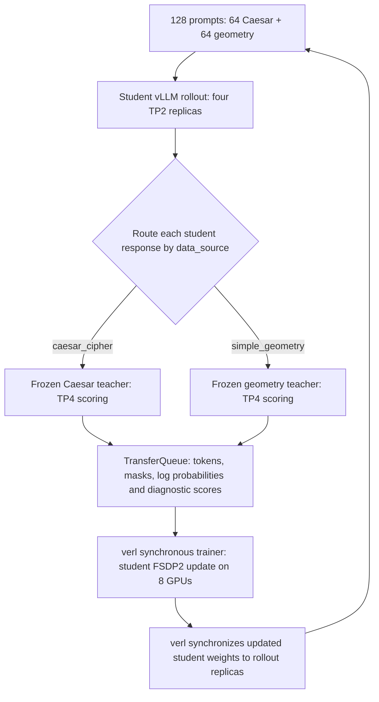

# Qwen3.6-35B-A3B synchronous multi-teacher distillation


## Run the example

The entrypoint is [`../run_qwen3_6_35b_mopd_fsdp.sh`](../run_qwen3_6_35b_mopd_fsdp.sh),
following the other distillation examples' environment defaults, grouped Hydra
arguments, uv launch, and trailing command-line overrides. The full recipe is
in `config.yaml`. Training uses upstream synchronous MOPD; `metrics/runtime.py`
adds measurements via subclasses rather than changing verl's loss or engine.

Prepare the assets once (teachers need the checkpoint-layout conversion in
`prepare_models.py`), then launch on an existing Ray cluster with 16 B200 GPUs:

```bash
export MOPD_ASSETS=/shared/mopd/assets
export MOPD_DATA=/shared/mopd/data
export MOPD_OUTPUT=/shared/mopd/runs/run-001  # fresh directory, shared by both nodes
uv run --frozen --all-packages --extra vllm --extra fsdp python3 -m examples.on_policy_distillation_trainer.qwen3_6_35b_mopd.prepare_models "$MOPD_ASSETS"
uv run --frozen --all-packages --extra vllm --extra fsdp python3 -m examples.on_policy_distillation_trainer.qwen3_6_35b_mopd.prepare_data "$MOPD_DATA"
bash examples/on_policy_distillation_trainer/run_qwen3_6_35b_mopd_fsdp.sh
```

The checkout and data must be available at the same paths on both Ray nodes.
For Slurm/Pyxis, use `allocate.sh` / `run_in_allocation.sh` as documented below;
`run_slurm_node.sh` starts the Ray cluster and calls the same entrypoint on its
head node. `VERL_USE_UV=0` uses an already prepared Python environment.

### Files

- `config.yaml`: training, teacher routing, evaluation, and measurement settings.
- `prepare_models.py`, `prepare_data.py`, `reward.py`: checkpoint preparation,
  benchmark data conversion, and diagnostic task scoring.
- `metrics/runtime.py`: measured trainer and rollout-worker subclasses.
- `metrics/aggregation.py`, `metrics/teacher_timing.py`: metric accounting and
  teacher execution timing. The latter is newly added and needs GPU validation.
- `metrics/report.py`, `metrics/plot_report.py`: CSV export and Matplotlib figures.
- `metrics/test_*.py`: accounting and instrumentation checks.
- `allocate.sh`, `run_in_allocation.sh`, `submit.slurm`, `run_slurm_node.sh`:
  optional Slurm/Pyxis orchestration with reusable allocations.

This example follows upstream `run_qwen3_8b_mopd_fsdp.sh`: student-generated
trajectories, a frozen teacher selected by `data_source`, sampled-token `k1`
distillation as a policy gradient, and no task-reward term. It uses the current
V1 synchronous trainer and FSDP2. All changes are confined to this example;
there are no OPD-benchmark training patches and no changes to verl core.

Teacher evaluation is disabled by default (`MOPD_EVAL_TEACHERS=0`), as requested
for this run. Student evaluation remains enabled at steps 0, 10 and 20.
Existing teacher scores can be supplied with `MOPD_TEACHER_BASELINES`; without
that file, independently measured baseline metrics are omitted, while the
published teacher references and their labelled gaps are still logged.
Teacher scoring during distillation still runs and retains its telemetry.
Each named teacher explicitly sets `inference.load_format: auto`. Named entries
do not inherit the default `teacher_model` entry's `load_format: auto`; omitting
it falls back to `RolloutConfig.load_format="dummy"`. Teachers receive no student
actor weight synchronization, so dummy loading would silently train against
uninitialized weights. Preflight and the task runner reject that configuration.
The selected model cards report Caesar **73.3%** at step 125 and geometry
**99.8%** at step 50. These are held-out seed-10000 exact-match **avg@4** scores
at temperature 1.0, top-p 1.0, 32k context with thinking. They are recorded as
`eval/teacher_reported/<domain>/avg_at_4`. Student evaluation now uses the same
four-sample, temperature-1.0, top-p-1.0 settings (top-k disabled), and logs
`eval/student/<domain>/avg_at_4` plus its gap to the published reference. The
cards specify the evaluation seed but do not supply hashes of their exact
examples, so these remain labelled published references.
Source links and sampling settings are retained in the resolved configuration.

**Validation scope:** seven CPU tests passed inside the prepared runtime,
covering metric arithmetic, checkpoint tensor fidelity, scoring, tokenizer
output normalization and Hydra configuration. Container import, runtime setup,
teacher checkpoint conversion, GPU preflight and teacher model loading have
also been exercised. These checks alone do not establish a successful training
benchmark; that requires completed updates and inspection of their metrics.

## Design: how this example calls verl

This is a configuration and instrumentation layer around verl's existing
**synchronous, multi-teacher on-policy distillation** implementation. It adapts
the configuration pattern in [the canonical MOPD example](../run_qwen3_8b_mopd_fsdp.sh)
to the Qwen3.6 student, the two domain-specific teachers and this cluster.
It does not invoke that shell script or copy its training loop. Instead,
[config.yaml](config.yaml) inherits verl's `ppo_trainer` Hydra configuration,
and [metrics/runtime.py](metrics/runtime.py) calls verl's Python APIs directly. The benchmark
repository supplies the recipe reference and immutable datasets; none of its
training patches are imported.

### Launch and initialization

The reusable allocation path is:

```text
allocate.sh
  └─ salloc --no-shell: reserve two nodes for four hours
     └─ run_in_allocation.sh JOB_ID: start one isolated attempt
        └─ bash submit.slurm: record inputs and launch a Slurm step
           └─ srun --jobid=JOB_ID: one Pyxis container on each node
              └─ run_slurm_node.sh → ../run_qwen3_6_35b_mopd_fsdp.sh
                 ├─ prepare/reuse runtime and model assets; run preflight
                 ├─ start one Ray head and one Ray worker; verify 16 GPUs
                 └─ python -m examples.on_policy_distillation_trainer.qwen3_6_35b_mopd.metrics.runtime
```

`submit.slurm` serves both launch modes. When called with `bash` from the
allocation wrapper, its `#SBATCH` lines are comments and its explicit
`srun --jobid` uses the existing allocation. When submitted with `sbatch`,
those directives request a new, one-shot batch allocation. The reusable path
keeps the allocation alive after an attempt exits; its filesystem lock permits
one attempt at a time, and every attempt gets a fresh output directory.

Pyxis runs the pinned official verl CUDA image on both nodes. The optional
[bootstrap_runtime.sh](bootstrap_runtime.sh) materializes the checkout's frozen
vLLM/FSDP dependencies under `/opt/verl-venv`; named containers retain that
environment between attempts. `PYTHONPATH` points at the mounted checkout, so
the Python process imports this checkout's verl source and example code while
using the container's dependencies. Both the driver and Ray actors use the
same interpreter. A fresh attempt rereads source changes, but it does not
resume training checkpoints; `trainer.resume_mode=disable` is intentional.

Inside `metrics/runtime.py`, Hydra resolves the inherited config and the command-line
overrides. The entry point calls:

```python
run_ppo(config, task_runner_class=TaskRunner)
```

Upstream [run_ppo](../../../verl/trainer/main_ppo.py) connects to Ray and launches
the example's `TaskRunner` actor. That actor validates the recipe, creates the
telemetry collector, initializes TransferQueue, then performs:

```python
trainer = MeasuredTrainer(config=config)
trainer.init()
manager = MeasuredAgentLoopManager.create(
    config=config,
    llm_client=trainer.get_llm_client(),
    teacher_client=trainer.get_teacher_client(),
    reward_loop_worker_handles=trainer.get_reward_handles(),
)
trainer.fit(manager)
```

The inherited `trainer.init()` creates verl's datasets, resource pools, FSDP2
actor workers, vLLM rollout replicas, teacher servers and synchronization
machinery. The inherited `fit()` owns the training loop, evaluation schedule,
checkpointing and scalar logging. There is no example-specific optimizer loop.

### Data and model flow in one training step



1. The inherited trainer dispatches the next 128 prompts through the agent-loop
   manager. The prepared dataset's ordering preserves the 64/64 domain split.
2. The student generates one response per prompt. The student rollout engines
   share the actor's eight GPUs; they are separate serving replicas of the
   current student weights, not additional teacher models.
3. Upstream agent-loop postprocessing computes the diagnostic exact-match score
   and asks the teacher client for log probabilities on the **student-generated
   sequence**. `distillation.teacher_key=data_source` selects exactly one
   teacher: Caesar for Caesar samples, geometry for geometry samples. The
   teachers are specialists selected by domain, not an ensemble averaged on
   every sample. Their weights remain frozen.
4. Upstream [AgentLoopWorkerTQ](../../../verl/trainer/ppo/v1/agent_loop_tq.py)
   publishes the completed trajectory to TransferQueue. The trainer's replay
   buffer waits for the batch. TransferQueue is the transport/storage layer;
   using it does not make this recipe asynchronous.
5. Upstream [PPOTrainerSync](../../../verl/trainer/ppo/v1/trainer_sync.py) puts
   the colocated student rollout replicas to sleep for training. The base
   trainer balances the batch, computes student log probabilities and the
   required intermediate fields, and runs the FSDP2 actor update.
6. At the end of the step, verl synchronizes the updated student weights to its
   rollout replicas before the next training batch. Student evaluation and
   checkpointing run at their configured intervals.

The two resource pools each request eight GPUs: the actor/rollout pool uses one
node, while the two TP4 teachers share the other. Ray chooses their placement;
the Slurm head node is not necessarily the actor node. Within a step, teacher
scoring can overlap with other requests still generating. Across training
steps, generation and actor updates follow the synchronous weight-sync cycle.

### What provides the learning signal

The objective is upstream [verl distillation loss](../../../verl/trainer/distillation/losses.py),
configured with `loss_mode=k1`, `use_policy_gradient=true` and
`use_task_rewards=false`. On sampled response tokens, `k1` estimates reverse
KL from the student and routed teacher log probabilities. Verl applies the
configured clamping and feeds the **negative, detached tokenwise distillation
loss** into its policy-gradient loss. Only the student's parameters are updated.
The inherited `topk=64` setting is inactive for this sampled-token `k1` estimator.

Although the inherited configuration says `algorithm.adv_estimator=grpo`, this
run is not training the student from the tasks' correctness rewards: verl zeros
the task-reward policy-loss contribution when `use_task_rewards=false`.
[reward.py](reward.py) supplies exact-match diagnostics and evaluation scores,
checking the answer after `</think>`. There is no learned value critic and no
separate reference-policy model. The requested "critic" performance metrics
therefore describe the two frozen teachers' scoring work.

### What the example adds to upstream execution

| Example component | Responsibility | Upstream work it delegates |
|---|---|---|
| `config.yaml` | Model paths, domain routing, GPU layout, recipe, evaluation and output settings | Hydra merges the remaining defaults from `verl.trainer.config` |
| `TaskRunner` | Recipe guards, collector creation and lifecycle wiring | `run_ppo`, trainer initialization, TransferQueue and `fit()` |
| `MeasuredTrainer(PPOTrainerSync)` | Times dispatch/wait, aggregates step metrics, attaches teacher reference scores | The inherited training loop, actor updates, weight sync, checkpoints and evaluation |
| `MeasuredAgentLoopManager(AgentLoopManagerTQ)` | Records batch submission and selects the measured worker class | Upstream prompt dispatch and agent-loop scheduling |
| `MeasuredWorker(AgentLoopWorkerTQ implementation)` | Records generation lengths/latency, teacher-scoring boundaries and failures | Upstream generation, reward scoring, teacher queries and queue publication via `super()` |
| `Collector` and `metrics/aggregation.py` | Retain events, use one clock for batch boundaries, compute P50s, rates and FLOP estimates | Preserve native verl metrics and add results to its existing logger |
| `prepare_data.py`, `prepare_models.py`, `preflight.py` | Adapt data/checkpoint formats and check compatibility/provenance | Standard HF checkpoints, tokenizers and verl input schemas |
| `report.py` | Export step-aligned scalar/evaluation CSVs | Reads the JSONL written by verl's file logger |

The worker subclass accesses Ray's `__ray_metadata__.modified_class` because
the upstream worker is already Ray-decorated. The FLOP calculation also uses
verl's architecture-specific estimator. These are version-sensitive integration
points, which is why the checkout, dependency lock and preflight are pinned.
No core verl files or OPD-benchmark runtime patches are needed for these hooks.

### Evaluation is a separate path

`trainer.fit()` runs student validation at steps 0, 10 and 20 using the same
student rollout engines, with **four samples per prompt**, temperature 1.0,
top-p 1.0, top-k disabled and thinking enabled. The response cap remains 30,720
tokens with a 2,048-token prompt budget. Training still uses one sample per
prompt. Validation bypasses the example's training-request timing hooks and
does not query the teachers for distillation targets.

The custom trainer aliases verl's per-domain `acc/mean@4` to student avg@4 and
logs the published teacher references and their labelled gaps. Teacher scoring
on training trajectories is still required, even though standalone teacher
evaluation is disabled. `evaluate_teachers.py` is an optional utility, invoked
only when `MOPD_EVAL_TEACHERS=1`; existing model-card scores do not require it.

For measurement boundaries, denominators and the difference between request
P50s and logical-batch P50s, see [Metric contract](#metric-contract) below.

## Pinned inputs

| Input | Repository | Revision |
|---|---|---|
| verl | [verl-project/verl](https://github.com/verl-project/verl) | `518ebcdbd42d670a8849b706903e069db0c7127b` |
| Recipe/data reference | [opd-benchmark](https://github.com/SemiAnalysisAI/opd-benchmark/blob/383c8f49a6f4b350ae2ddf3d4b7e0e92d917c2c3/frameworks/README.md) | `383c8f49a6f4b350ae2ddf3d4b7e0e92d917c2c3` |
| Student | [Qwen/Qwen3.6-35B-A3B](https://huggingface.co/Qwen/Qwen3.6-35B-A3B) | `995ad96eacd98c81ed38be0c5b274b04031597b0` |
| Caesar teacher | [semianalysisai/Qwen3.6-35B-A3B-caesar-cipher-GRPO-20260924](https://huggingface.co/semianalysisai/Qwen3.6-35B-A3B-caesar-cipher-GRPO-20260924) | `dfedf677a5bf08a451733ec48c845c2661a6ab14` (`step-125`) |
| Geometry teacher | [semianalysisai/Qwen3.6-35B-A3B-simple-geometry-GRPO-20260925](https://huggingface.co/semianalysisai/Qwen3.6-35B-A3B-simple-geometry-GRPO-20260925) | `679d4b66018c03249a3bfd0ecca3195ed9cd0e0d` (`step-50`) |

Qwen3.6 identifies itself as `qwen3_5_moe` / `Qwen3_5MoeForConditionalGeneration`.
The upstream engine and hybrid-attention MoE FLOP estimator support that type.
Training is text-only; the vision tower is frozen and MTP is disabled.

The teacher Hub snapshots contain separate `experts.N.{gate,up,down}_proj`
tensors. `prepare_models.py` packs these into the base checkpoint's fused
expert format. It preserves the teacher weights, checks every resulting shape,
rejects unused/missing trained tensors, and adds only the base's unused MTP
tensors. Conversion finishes by atomically renaming a unique `.partial-*` directory.
Retries reuse completed conversions only after checking their pinned provenance,
index hash and shard sizes. Interrupted conversion directories are retained;
a retry uses a new directory and resumes Hub downloads from their existing cache.
The training code does not import any benchmark framework implementation.

## Recipe and placement

| Setting | Value |
|---|---|
| Updates / LR | 20 / AdamW `1e-6`, weight decay 0, betas 0.9/0.999 |
| Batch / samples | 128 prompts, 64 per domain in file order, one response each |
| Prompt / response | 2,048 / 30,720 tokens; thinking on |
| Model length | 32,769 to accommodate the teacher's extra scoring token; student prompt+response remains at most 32,768 |
| Actor | FSDP2 over 8 B200s, dynamic batches with 32,768 tokens/GPU, checkpointing, CPU parameter/optimizer offload between phases |
| Student rollout | Four TP2 vLLM replicas, colocated on those same 8 GPUs |
| Teachers | One TP4 replica per domain on a separate 8-GPU pool |
| Eval / save | Student eval at 0, 10, 20; checkpoints at 10, 20 |
| Eval data | Full fixed dev sets: 126 Caesar, 128 geometry; four samples each, temperature 1.0, top-p 1.0, thinking on |
| CPUs | Slurm 80/node, Ray 64/node |

Slurm reserves **2 nodes × 8 B200 = 16 GPUs**. Ray selects the physical nodes
and GPU IDs for the two pools; do not assume that the Ray head hosts the actor.
Teacher TP4 uses the whole second node and accommodates long-context prefill.
This is a deliberate synchronous layout, unlike the reference benchmark's
8 trainer + 6 separate rollout + 2 teacher GPUs and policy lag up to one.
There is zero training-policy lag here. Throughputs across those layouts are
not directly comparable without accounting for resource allocation.

The fixed interleaved dataset gives exact 64/64 batches when all samples
succeed. No reward-variance filter or rejection sampling is enabled. Failures
can reduce the usable domain counts; they are reported. Overlong source
prompts fail preflight instead of silently changing the dataset.

## Metric contract

The requested “critic” measurements are **teacher scoring**, as agreed. There
is no value critic. The native diagnostic keys that happen to start with
`critic/` must not be interpreted as evidence of a running value model.

| Requested measurement | Native coverage / addition |
|---|---|
| Student eval versus teachers | Native `<prefix>/<domain>/acc/mean@4`; adds student avg@4, published teacher avg@4 and labelled gaps |
| Every trainer step, wait and train | Native `timing_s/{step,gen,update_actor,old_log_prob,update_weights,save_checkpoint,testing}`; adds explicit `trainer/{step_s,wait_s,train_s,other_s,eval_s}` |
| Average train time, MFU, tok/s/GPU | Preserves native `perf/mfu/actor`; adds actor-only timed rates and cumulative time-weighted rates |
| Rollout end-to-end latency P50 | Adds request P50 and logical-batch generation/ready latency P50 |
| Input/output length P50 | Adds unpadded token-count medians within each logical rollout batch; raw records retained |
| Rollout throughput, filtered ratio, effective throughput | Adds makespan-based role-normalized rates, actual accepted-key accounting, and failure counters |
| Teacher batch latency/MFU/throughput P50 | Adds each domain's scoring-window duration, forward FLOP estimate, scored tok/s/GPU, and request latency P50 |

**Statistical unit:** a logical rollout batch is one call dispatching 128
prompts, not an internal vLLM scheduler microbatch. Normal synchronous steps
have one logical rollout batch and one logical scoring batch per teacher;
their batch P50 is necessarily the single observed value. Request latency and
length P50s have 128 (or 64/domain) observations. Both levels are retained.
Internal vLLM continuous-batching microbatch P50s would require additional
engine instrumentation; this example does not claim to measure those.

**Timing boundaries:**

- `trainer/step_s` is upstream's training step timer: dispatch, generation
  wait, log-prob computation, advantages, actor update, checkpointing, weight
  sync. Evaluation, metric aggregation, log I/O, and startup are outside it.
- `wait_s` is synchronous prompt dispatch plus waiting for the replay batch.
  `train_s` is the actor-update RPC boundary, including its transfers/offload.
  `other_s = step_s - wait_s - train_s` preserves the remaining work instead of
  mislabelling it as idle time. `step_plus_eval_s` adds evaluation explicitly.
- Request generation latency is the upstream vLLM client call. Request
  end-to-end latency starts before the agent loop and ends after scoring,
  immediately before TransferQueue publication. It includes tokenization,
  serving queues, teacher scoring, reward scoring, and client-side processing.
- Rollout batch generation time runs from dispatch to the last generation
  result; batch ready time ends when the last result is ready to publish.
- Teacher batch time spans the first submitted scoring request through the
  last completed scoring request for that domain. It includes service queues
  and supply gaps while the student is still producing responses. Request
  latency is reported separately. It is not a CUDA kernel-only timer.

**Throughput arithmetic:** for each batch, raw rollout throughput is
`sum(generated response tokens) / (generation seconds × 8)`; effective
throughput replaces the numerator with response loss-mask tokens from
trajectories actually accepted into that update. An additional ready-throughput
uses batch ready time. The filtered ratio is discarded completed trajectories
divided by all completed generation trajectories. Failed requests are counted
separately; tokens lost before a generation result arrives are unknown, so raw
throughput is only a lower bound when `unknown_output_requests > 0`.

Teacher throughput uses **input + response tokens scored**, divided by that
teacher's scoring window and **4 GPUs**. Actor throughput uses unpadded
prompt+response tokens processed per PPO epoch, actor-update seconds, and
**8 GPUs**. Neither divides by median request latency or sums overlapping
request times. Tokens/GPU count TP replicas once, not once per TP rank.

**Teacher active and wait time (future runs):** `metrics/teacher_timing.py` supplies
example-local vLLM worker subclasses through each teacher's `engine_kwargs.vllm.worker_cls`.
On TP rank zero, CUDA synchronization brackets each `execute_model` call.
The sum of these completed call durations is `active_s`; `wait_s` is the
scoring window minus `active_s`. Active time includes CPU dispatch and TP
communication inside model execution, not just GPU kernels. Wait time includes
rollout supply gaps, scheduling, result processing, sampling outside
`execute_model`, and instrumentation overhead; it is not exclusively rollout wait.
Synchronization can reduce overlap and affect measured performance.

The collector publishes the step/batch marker before rollout dispatch. Each
teacher appends execution durations to `teacher-execution-<domain>.jsonl` in
the shared run directory before returning its model result. The trainer checks
and exports `active_s`, `wait_s`, and `execution_calls` in `batches.jsonl` and
`teacher_batches.csv`, plus per-step scalar active/wait metrics. This supports
the example's synchronous, one-batch-per-step, one-replica-per-teacher layout
with no pipeline parallelism. Missing timing fails explicitly instead of
reporting zero. Existing run artifacts have no execution timings and are not
backfilled. Existing throughput and MFU fields retain their scoring-window
denominator; the teacher system-performance graph labels these percentages
"Step Time MFU". Here the time denominator is the teacher scoring window,
including wait, rather than the entire trainer step or active execution alone.

**MFU:** `model_FLOPs / (seconds × role_GPUs × peak_FLOPs_per_GPU)`.
The upstream Qwen3.5 hybrid-attention estimator accounts for routed/shared
experts and linear/full-attention layers. Teacher forward FLOPs use its training
estimate divided by three, matching upstream `EngineWorker`'s forward-only
convention. This is an explicitly labelled **estimate**, not GPU utilization
from `nvidia-smi`. It excludes vision, unused MTP and the teacher's extra one
decode token, and does not claim exact recomputation/kernel FLOPs. Prefix
caching is disabled to avoid counting reused prefill as newly executed work.
The default peak is upstream's B200 value, **2250 TFLOP/s/GPU**; record/override
`measurement.bf16_peak_tflops_per_gpu` for a different hardware convention.

Cumulative train throughput divides total processed tokens by total train
GPU-seconds; cumulative MFU divides total estimated FLOPs by total peak
GPU-seconds. Neither is an unweighted average of per-step percentages.

The collector assigns all batch timestamps on **one monotonic clock**, avoiding
cross-node wall-clock subtraction. A few small, awaited Ray RPCs per long
request add measurement overhead, included in the boundary timings. Raw
events support auditing. The extension subclasses a Ray-decorated upstream
worker through `__ray_metadata__.modified_class`; this version-sensitive API
is why the checkout and container lock are pinned and preflight imports it.

## Build the proper verl container

Use the pinned checkout's official CUDA 13 uv image definition, then freeze
the selected vLLM/FSDP environment in the derived image. The older
`vllm024` image does not match this checkout's vLLM 0.29/torch 2.13 lock.
These commands are preparation instructions, not operations already run:

```bash
cd /shared/verl
docker build -f docker/Dockerfile.uv.cu130 -t verl:uv-cu130 .
docker build -f examples/on_policy_distillation_trainer/qwen3_6_35b_mopd/Dockerfile \
  -t verl:qwen36-mopd .
mkdir -p /shared/images
enroot import -o /shared/images/verl-qwen36-mopd.sqsh \
  dockerd://verl:qwen36-mopd
```

The runtime environment lives at `/opt/verl-venv`, so mounting the source tree
does not hide it. Both Ray nodes and every Python worker use that interpreter.
With the prebuilt derived image, no dependency installation runs inside the Slurm allocation. The image lock
must match the mounted checkout. The launcher records the squashfs SHA256,
source snapshot, package inventory, resolved config and source revision.
GPU driver compatibility and any site-specific fabric settings remain part
of the first GPU preflight; no networking interface is guessed here.

Alternatively, set `MOPD_BOOTSTRAP=1` and use the official Pyxis image reference
`registry-1.docker.io#verlai/verl:sha256:53aa78ecb8c86637d41636a21e88bdd8b18bfb9a753e812dbe321fd6f922deb5`.
This CUDA 13.0.2 image requires no host Docker access. Each node materializes
the checkout's frozen vLLM/FSDP dependencies in its private `/opt/verl-venv`;
the head downloads and converts the pinned model assets if `models.json` is
absent. Preparation, teacher baseline evaluation, and training all consume
the same four-hour allocation. Per-node bootstrap logs and `prepare-models.log`
are written in the run directory. The image digest is recorded separately
from the runtime package inventory. This path needs outbound network access
on compute nodes; container setup and GPU preflight have been exercised.

## Prepare and submit

### Reusable salloc allocation

`allocate.sh` requests **two nodes / 16 B200s for four hours**, named
`inferencex-mopd`, using `salloc --no-shell`. It launches the first training
attempt once the allocation is granted. Run it in a detached terminal so the
allocation request survives disconnects while queued:

```bash
tmux new-session -d -s inferencex-mopd \
  'bash /shared/verl/examples/on_policy_distillation_trainer/qwen3_6_35b_mopd/allocate.sh'
```

Request logs and the granted job ID are under the workspace's `allocations/`.
The allocation remains active after an attempt fails **or succeeds**. After
fixing the code, rerun on the same allocation:

```bash
bash examples/on_policy_distillation_trainer/qwen3_6_35b_mopd/run_in_allocation.sh JOB_ID
```

Each attempt uses a fresh output directory and log; attempts are serialized
with a filesystem lock. Named Pyxis containers preserve each node's prepared
environment. The bootstrap reruns only if its script or `uv.lock` changes.
Slurm cleans the terminated step's processes before the next step can acquire
its GPUs; Ray temporary directories are unique to each step. Completed model
assets and verified teacher baselines are reused. Training restarts from the
original student checkpoint; this is allocation reuse, not checkpoint resume.

Use `scancel JOB_ID` to release the allocation when finished. The four-hour
clock starts when resources are granted and includes preparation and debugging;
retries do not reset it. Failures are retained for inspection, with no automatic
infinite retry loop. The allocation itself survives the launcher exiting.

### One-shot batch submission

Run preparation with the derived image's Python (or an equivalent prepared
environment). Model preparation downloads about three model copies and writes
two converted teacher copies; budget disk space before invoking it.

```bash
export VERL_ROOT=/shared/verl
export MOPD_ASSETS=/shared/assets
export MOPD_DATA=/shared/data/reasoning_gym
cd "$VERL_ROOT"
python -m examples.on_policy_distillation_trainer.qwen3_6_35b_mopd.prepare_models "$MOPD_ASSETS"
python -m examples.on_policy_distillation_trainer.qwen3_6_35b_mopd.prepare_data "$MOPD_DATA"
```

The data has already been prepared in the workspace, with all source hashes,
counts and 64/64 full-batch splits checked. Keep the model credentials in the
normal Hugging Face credential mechanism, outside the example.

```bash
export VERL_IMAGE=/shared/images/verl-qwen36-mopd.sqsh
export MOPD_OUTPUT=/shared/runs/qwen36-mopd-001
mkdir -p "$(dirname "$MOPD_OUTPUT")"
sbatch examples/on_policy_distillation_trainer/qwen3_6_35b_mopd/submit.slurm
```

The script uses this cluster's `batch_1` / `benchmark` / `batch_1_qos`; override
those `sbatch` options if necessary. It needs two available full nodes, not
just eight idle GPUs. The run directory must be new. The head first checks
assets/runtime. Optional teacher evaluation (`MOPD_EVAL_TEACHERS=1`) evaluates
each teacher on its own dev domain before training. The launcher uses one container per Slurm
node, waits for 16 Ray GPUs, and starts synchronous training. Teacher eval is
outside all training-step metrics. To reuse baselines, place an existing
`teacher-baselines.json` under a mounted shared directory and export
`MOPD_TEACHER_BASELINES` to its absolute path. Hashes, revisions and decoding
settings are checked for supplied matched-baseline files. Published model-card
avg@4 numbers remain separately labelled references with matched sampling settings.

For the first GPU smoke test, keep the 32k lengths and all settings but use a
fresh output directory and append `trainer.total_training_steps=1` to the
`sbatch` command. It evaluates the student (teacher evaluation remains opt-in); it exercises
real long-context memory, weight sync, and instrumentation. This is not yet a
20-step benchmark. After it succeeds, inspect loss, finite gradient norms,
teacher routing, all metrics, and the saved checkpoint, then submit the full
20-step run separately. Do not infer memory safety from a short-response test.

## Outputs and verification

- `metrics.jsonl`: native verl scalars plus the additions above, keyed by step.
- `events.jsonl`: dispatch/generation/scoring/ready/failure events with IDs.
- `batches.jsonl`: batch denominators, token counts, per-domain teacher metrics.
- `validation/`: student scores and responses, identified by training step.
- `teacher-eval/`, `teacher-baselines.json`: optional standalone teacher evaluation
  outputs, absent when that evaluation is disabled. Published references are
  retained in the resolved config and evaluation metrics.
- `checkpoints/`: upstream checkpoints, normally at steps 10 and 20.

Export step-aligned tables after training:

```bash
python -m examples.on_policy_distillation_trainer.qwen3_6_35b_mopd.metrics.report "$MOPD_OUTPUT"
```

This writes `metrics.csv` and `evaluation.csv`, plus focused `trainer.csv`,
`rollout_batches.csv` and `teacher_batches.csv` tables. The batch tables retain
each logical batch's token counts, denominators and request latency/length
medians; teacher rows identify the scoring model. Non-evaluation steps have empty
eval cells, not interpolated scores. An in-progress export contains only the
measurements written so far; rerun the exporter after training completes.
On this cluster, NFS metadata on the login node can lag active writes; reading
or exporting on the writer's compute node shows the current records.
The implementation intentionally rejects
resume, multiple training samples per prompt, non-sync modes, and token rejection
sampling until their more complex accounting is added.

To plot the exported snapshot (requires matplotlib):

```bash
python -m examples.on_policy_distillation_trainer.qwen3_6_35b_mopd.metrics.plot_report "$MOPD_OUTPUT"
```

This writes `training-summary.png`, `rollout-summary.png`, and
`teacher-summary.png`. Each figure states the last completed step it contains.
Teacher reference lines are published scores, and student evaluation markers
appear only at measured evaluation steps. Teacher batch windows include supply
gaps while student responses are generated; request latency is plotted separately.

CPU checks:

```bash
python -m unittest examples.on_policy_distillation_trainer.qwen3_6_35b_mopd.metrics.test_metrics -v
python -m unittest examples.on_policy_distillation_trainer.qwen3_6_35b_mopd.test_assets -v
python -m unittest examples.on_policy_distillation_trainer.qwen3_6_35b_mopd.metrics.test_runtime -v
bash -n examples/on_policy_distillation_trainer/qwen3_6_35b_mopd/run_slurm_node.sh
bash -n examples/on_policy_distillation_trainer/qwen3_6_35b_mopd/submit.slurm
```

## Upstream references audited

- [Canonical MOPD example](https://github.com/verl-project/verl/blob/518ebcdbd42d670a8849b706903e069db0c7127b/examples/on_policy_distillation_trainer/run_qwen3_8b_mopd_fsdp.sh)
- [OPD documentation](https://github.com/verl-project/verl/blob/518ebcdbd42d670a8849b706903e069db0c7127b/docs/algo/opd.md)
- [Installation/image documentation](https://github.com/verl-project/verl/blob/518ebcdbd42d670a8849b706903e069db0c7127b/docs/start/install.rst)
- [V1 trainer timing and validation](https://github.com/verl-project/verl/blob/518ebcdbd42d670a8849b706903e069db0c7127b/verl/trainer/ppo/v1/trainer_base.py)
- [Teacher serving](https://github.com/verl-project/verl/blob/518ebcdbd42d670a8849b706903e069db0c7127b/verl/experimental/teacher_loop/teacher_manager.py)
- [FLOP estimates](https://github.com/verl-project/verl/blob/518ebcdbd42d670a8849b706903e069db0c7127b/verl/utils/flops_counter.py)
